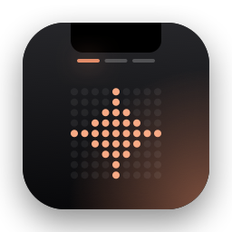
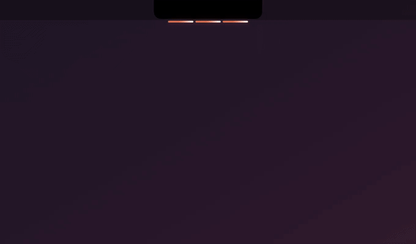

<div align="center">



# ClaudeNotch

**Your MacBook notch, watching your Claude Code sessions.**
Know when a run finishes, answer permission prompts and questions without going back to the
terminal, and keep a few handy tools one glance away.

**English** · [Türkçe](README.tr.md)




</div>

> The interface is in Turkish for now. ClaudeNotch is a personal open-source project, not an
> Anthropic product.

## What it does

- **Live status under the notch.** One thin segment per Claude Code session: orange while it
  works, amber when it needs you, green when it finished and you have not looked yet.
- **Permission requests in the notch.** An island drops down with the command; allow or deny
  with a click or **⌃⌥Y / ⌃⌥N** from any app. Risky commands (`rm -rf`, `sudo`, `curl … | sh`,
  `git push --force`, `git reset --hard`, uploads of local files…) need a short hold. Nothing is ever allowed by default.
- **Answer Claude's questions.** `AskUserQuestion` options show up as buttons; pick with a click
  or **⌃⌥1…4**, send with **⌃⌥Y**. Free text and plan approval stay in the terminal.
- **The panel.** Hover the notch: every session with its status, the turn's elapsed time in
  dot-matrix digits, a rhythm strip of its tool calls, subagents, and context left. Click a row
  to jump to its Ghostty / Terminal / iTerm2 tab.
- **Small tools, all optional:** Pomodoro / focus timer (it grows out of the notch while it
  runs), calendar reminders with a **Join** button (macOS Calendar or Google Calendar directly),
  Spotify cover and controls, a clipboard shelf with pinning, weather, plan usage, battery,
  quiet hours and a silent mode.
- **Light on the machine.** Event-driven: no polling loops while idle, ~40 MB with the panel
  closed. Works on external displays too (a pill stands in for the notch).

## Install

You need a Mac on **macOS 14 or later** (a notch is nice, not required) and
[Claude Code](https://claude.com/claude-code). On macOS 14 also `brew install jq` (macOS 15+
ships it).

### Option 1: download the app

1. Download `ClaudeNotch-<version>.zip` from the
   [latest release](https://github.com/eyyupcanisler/claude-notch/releases/latest), unzip it and
   move **ClaudeNotch.app** to **Applications**.
2. Open it. macOS blocks the first launch because the app is not signed with an Apple Developer
   ID: go to **System Settings → Privacy & Security** and click **Open Anyway**.
   (Or in Terminal: `xattr -dr com.apple.quarantine /Applications/ClaudeNotch.app`.)
3. Open **ClaudeNotch** again from Spotlight to get its Settings, then
   **Genel → Claude Code bağlantısı → Kancaları kur** (install hooks). It adds the hooks to
   `~/.claude/settings.json` after backing it up and leaves the rest of the file alone.

That's it: your next Claude Code message shows up in the notch.

### Option 2: build from source

Needs Xcode or the Command Line Tools (`xcode-select --install`) and `jq`.

```sh
git clone https://github.com/eyyupcanisler/claude-notch.git
cd claude-notch
scripts/make-signing-identity.sh   # once: a local signing identity, so macOS permissions stick
scripts/build-app.sh               # builds build.noindex/ClaudeNotch.app
scripts/install-app.sh             # copies it to ~/Applications and starts it
scripts/install-hooks.sh           # adds the hooks to ~/.claude/settings.json (backs it up first)
```

Either way: ClaudeNotch has no Dock icon, launching it again opens its Settings. Turn on
*Oturum açılışında başlat* (start at login) in the General tab.

Optional:

- `scripts/install-statusline.sh` adds one line to your status line script so the notch can show
  your plan usage (Claude Code only reports it to the status line).
- `scripts/install-hooks.sh --uninstall` removes the hooks again.

## How it works

```
Claude Code ── hook ──▶ hooks/claude-notch-hook.sh ── curl ──▶ Unix socket ──▶ ClaudeNotch.app
                                              ~/Library/Application Support/ClaudeNotch/notch.sock
```

- The socket lives in a `0700` folder, the socket itself is `0600`; there is no TCP port.
- `PermissionRequest` waits for your answer (up to ~10 min) side by side with the terminal
  prompt; answering in either place wins. If the app is not running the hook exits silently and
  Claude Code asks in the terminal as usual.
- A `PreToolUse` hook on `AskUserQuestion` holds the question until you answer it in the notch;
  switching to that session's terminal tab hands it back to the terminal.

## Shortcuts

| Keys | Action |
| --- | --- |
| ⌃⌥Space | Open the panel with the keyboard |
| ⌃⌥Y / ⌃⌥N | Allow / deny the request on screen (questions: send / answer in terminal) |
| ⌃⌥1 … ⌃⌥4 | Pick an option of the question on screen (only while one is shown) |
| ⌃⌥P | Start / pause a Pomodoro |
| ⌃⌥V | Copy the newest shelf item back to the clipboard |

All of them can be changed in Settings → *Kısayollar*.

## Google Calendar (optional)

ClaudeNotch can read Google Calendar directly with **your own** OAuth client (read-only):
create a Google Cloud project, enable the Calendar API, add an OAuth consent screen and a
**Desktop app** client, download its JSON and pick it in Settings → *Modüller* → *Takvim*. The
step-by-step guide is in the [Turkish README](README.tr.md#google-takvim-doğrudan-bağlantı).
Your client and tokens stay on your Mac in a `0600` file; nothing is sent anywhere but Google.

## Privacy

Everything runs locally. ClaudeNotch talks to Claude Code through a local socket and to the
network only for the modules you turn on (weather from Open-Meteo, Google Calendar, Spotify
artwork). The clipboard shelf never keeps items marked concealed by password managers.

## Development

```sh
swift build && swift test   # the Core library has the logic and the tests
scripts/demo/record.sh      # re-records docs/demo.gif with made-up sessions (needs ffmpeg)
scripts/make-release.sh 1.0.1  # builds the zip and publishes a GitHub release
```

`CLAUDE_NOTCH_DEBUG=1` enables `/debug/*` routes on the socket for UI tests; see the Turkish
README for the details.

## License

[MIT](LICENSE) © 2026 Eyyupcan Isler
