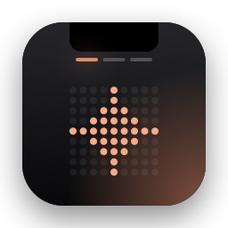
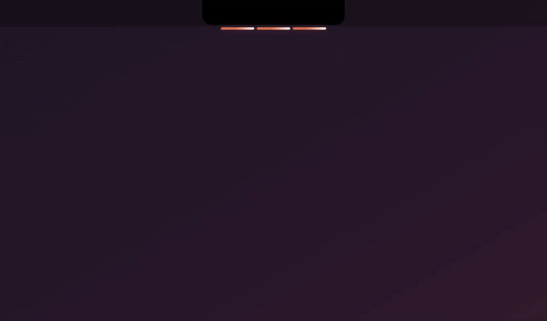

<div align="center">



# ClaudeNotch

**Your MacBook notch, watching your Claude Code sessions.**
Know when a run finishes, answer permission prompts and questions without going back to the
terminal, and keep a few handy tools one glance away.

**English** · [Türkçe](README.tr.md)




</div>

> The interface follows your Mac: Turkish when the Mac's first language is Turkish, English
> otherwise. Settings → *Genel → Dil* (General → Language) sets Türkçe or English instead, after
> a restart. Settings paths below give the Turkish label first, with the English one in
> parentheses. ClaudeNotch is a personal open-source project, not an Anthropic product.

## What it does

- **Live status under the notch.** One thin segment per Claude Code session. With the default
  **Classic** colors: color means "needs you" and nothing else. Solid grey with a moving shine
  while it works, amber with a slow fade when it needs you, near-white when it finished and you
  have not looked yet (it flashes once on arrival), red on an error, faint white when idle.
  Settings → *Genel → Görünüm → Durum renkleri* → **Renk körlüğüne uygun** (General →
  Appearance → Status colors → Colorblind-friendly) switches at once to colors that stay apart for red-green color blindness, plus shape signs:
  grey `#8E8E8E` with a moving shine = working, yellow `#F0E442` with a slow fade = needs you,
  near-white `#E8E8E8` = done, a broken pink-red `#FB7185` bar (three short dashes) = error,
  faint white = idle; only needs-you and error are colored in both palettes, and the shapes
  tell the states apart even in grayscale. With Reduce Motion on, the shine and
  the fade stop, so working, needs you and done are told apart by color and brightness only.
- **"Done" means done.** When the chat's turn ends while a workflow or background agent it
  started still runs (Claude Code lists it in the `Stop` hook), the session stays "working",
  shown as "In the background: …", with no done wing or chime, no "quiet for 10 min" note
  and no "waiting for your input". The done comes when that work is back and the turn really
  ends. A background shell or monitor (a dev server, a log watch) does not hold it.
- **Nothing drops down.** Permission requests, questions, plan approvals, finished runs, errors
  and module notes never expand below the menu-bar band, so what is under it (browser tabs)
  stays clickable. The notch grows sideways instead, at the same height ("wings"): for 4 s the
  left wing says who and what ("claude-notch wants to run") and the right wing the detail (the
  command, the question's first words), then both shrink to a small colored mark (a dot and a
  shield, ?, ! or check; a count when several are waiting). Permission and question marks stay
  until answered, an error mark until seen; done and module notes leave no mark. Settings →
  *Bildirimler → Çentiğin yanında yalnızca küçük bir işaret göster* (Notifications → Show only a
  small mark beside the notch; also under General → Appearance; default off) skips the 4 s of
  text. Clicking the wings opens the panel (a terminal-only question jumps to its terminal);
  hovering the notch opens the panel as before.
- **Permission requests in the notch.** The wings show the command; allow or deny
  with **⌃⌥Y / ⌃⌥N** from any app, or click the wings to open the panel. Risky commands (`rm -rf`, `sudo`, `curl … | sh`,
  `git push --force`, `git reset --hard`, uploads of local files…) need a short hold. Nothing is ever allowed by default.
  Optional: Settings → *Bildirimler → Terminali öndeyken kanatları gizle* (Notifications → Hide
  wings while their terminal is in front; default off): while the session's terminal app is
  the front app, whichever of its tabs you are in, its permission requests, plan approvals and
  "waiting for input" notices show no wing: answer them in the terminal. A wing already showing
  goes away when you switch to that terminal. Requests still wait in the panel; one you leave
  unanswered comes back as a small mark once that terminal is no longer in front (never as the
  4 s text).
- **Answer Claude's questions.** `AskUserQuestion` options show up as buttons; pick with a click
  or **⌃⌥1…4**, send with **⌃⌥Y**. Free text and plan approval stay in the terminal.
  Prefer the terminal? Turn off Settings → *Bildirimler → Claude’un sorularını çentikte
  yanıtla* (Notifications → Answer Claude's questions in the notch): the terminal then asks at
  once, and the notch only tells you. The session's segment fades slowly in the "needs you"
  color, the wings say "<project> asks:" with the question's first words, and a click on them
  jumps to that session's terminal tab. If that terminal app (Ghostty, Terminal, iTerm2…; not an
  editor such as VS Code) is the front app when the question arrives, no wing shows: you are
  looking at the question, and **⌃⌥J** still jumps to the tab. A wing already showing goes away
  when you switch to that terminal; leave it unanswered and its small mark comes back.
- **Jump to what needs you.** **⌃⌥J** brings forward the terminal tab of the session that needs
  you most: a permission request first, then a question, plan approval or input wait, then an
  unseen error, then an unseen finished run.
- **Terminal bell (optional).** Settings → *Bildirimler → Claude Code bildirim gönderince
  terminal zilini çal* (Notifications → Ring the terminal bell when Claude Code notifies;
  default off) rings that session's terminal bell on every Claude Code notification
  (permission, question, waiting for input): Ghostty puts 🔔 on the tab until you look at it,
  Terminal and iTerm2 mark the tab (and beep, unless their bell is set to visual). In silent
  mode only what needs an answer rings. Nothing rings while the app is not running. If Claude
  Code itself is set to ring the bell (`preferredNotifChannel`: `terminal_bell`), each
  notification rings twice.
- **The panel.** Hover the notch: every session with its status, the turn's elapsed time in
  dot-matrix digits, a rhythm strip of its tool calls, subagents, and context left. Click a row
  to jump to its Ghostty / Terminal / iTerm2 tab.
- **Small tools, all optional:** Pomodoro / focus timer (it grows out of the notch while it
  runs), calendar reminders with a **Join** button (macOS Calendar or Google Calendar directly),
  Spotify cover and controls, a clipboard shelf with pinning, weather, plan usage, battery,
  quiet hours and a silent mode.
- **Light on the machine.** Event-driven: no polling loops while idle, ~40 MB with the panel
  closed. Works on external displays too (a pill stands in for the notch).

## Install

You need a Mac on **macOS 14 or later** (a notch is nice, not required) and
[Claude Code](https://claude.com/claude-code). On macOS 14 also `brew install jq` (macOS 15+
ships it).

### Option 1: download the app

1. Download `ClaudeNotch-<version>.zip` from the
   [latest release](https://github.com/eyyupcanisler/claude-notch/releases/latest), unzip it and
   move **ClaudeNotch.app** to **Applications**.
2. Open it. macOS blocks the first launch because the app is not signed with an Apple Developer
   ID: go to **System Settings → Privacy & Security** and click **Open Anyway**.
   (Or in Terminal: `xattr -dr com.apple.quarantine /Applications/ClaudeNotch.app`.)
3. Open **ClaudeNotch** again from Spotlight to get its Settings, then
   **Genel → Claude Code bağlantısı → Kancaları kur** (General → Claude Code connection →
   Install hooks). It adds the hooks to
   `~/.claude/settings.json` after backing it up and leaves the rest of the file alone.

That's it: your next Claude Code message shows up in the notch.

### Option 2: build from source

Needs Xcode or the Command Line Tools (`xcode-select --install`) and `jq`.

```sh
git clone https://github.com/eyyupcanisler/claude-notch.git
cd claude-notch
scripts/make-signing-identity.sh   # once: a local signing identity, so macOS permissions stick
scripts/build-app.sh               # builds build.noindex/ClaudeNotch.app
scripts/install-app.sh             # copies it to ~/Applications and starts it
scripts/install-hooks.sh           # adds the hooks to ~/.claude/settings.json (backs it up first)
```

Either way: ClaudeNotch has no Dock icon, launching it again opens its Settings. Turn on
*Oturum açılışında başlat* (Open at login) in the *Genel* (General) tab.

Optional:

- `scripts/install-statusline.sh` adds one line to your status line script so the notch can show
  your plan usage (Claude Code only reports it to the status line). The ring shows the fuller of
  the 5-hour and weekly windows, and the notch warns at 80% and 95% of the 5-hour limit. When the
  status line passes only the weekly window (`rate_limits.seven_day`, as newer Claude Code
  does), the ring follows the weekly limit; the warnings then come only with Settings →
  *Modüller → Haftalık limit %80’e, sonra %95’e gelince uyar* (Modules → Warn when the weekly
  limit reaches 80%, then 95%; default off).
- `scripts/install-hooks.sh --uninstall` removes the hooks again.

## How it works

```
Claude Code ── hook ──▶ hooks/claude-notch-hook.sh ── curl ──▶ Unix socket ──▶ ClaudeNotch.app
                                              ~/Library/Application Support/ClaudeNotch/notch.sock
```

- The socket lives in a `0700` folder, the socket itself is `0600`; there is no TCP port.
- `PermissionRequest` waits for your answer (up to ~10 min) side by side with the terminal
  prompt; answering in either place wins. If the app is not running the hook exits silently and
  Claude Code asks in the terminal as usual.
- A `PreToolUse` hook on `AskUserQuestion` holds the question until you answer it in the notch;
  switching to that session's terminal tab hands it back to the terminal. With *Claude’un
  sorularını çentikte yanıtla* (Answer Claude's questions in the notch) off, the app answers that hook empty at once, so Claude Code asks in
  the terminal as usual and the fire-and-forget `PreToolUse` / `PermissionRequest` events only
  tell the notch that Claude is asking.

## Shortcuts

| Keys | Action |
| --- | --- |
| ⌃⌥Space | Open the panel with the keyboard |
| ⌃⌥Y / ⌃⌥N | Allow / deny the request on screen (questions: send / answer in terminal) |
| ⌃⌥1 … ⌃⌥4 | Pick an option of the question on screen (only while one is shown) |
| ⌃⌥J | Jump to the terminal tab of the session that needs you |
| ⌃⌥P | Start / pause a Pomodoro |
| ⌃⌥V | Copy the newest shelf item back to the clipboard |

All of them except ⌃⌥1 … ⌃⌥4 can be changed in Settings → *Kısayollar* (Shortcuts); the option
keys stay ⌃⌥1 … ⌃⌥4 with every preset. **Caps Lock kullan (Hyper tuşu)** (Use Caps Lock (Hyper
key)) there switches every shortcut to ⌃⌥⇧⌘ + the same key (Caps Lock + Y allows, Caps Lock + J
jumps...), and **Varsayılana dön** (Reset to defaults) goes back to ⌃⌥. Nothing changes until
you press one of them. The Hyper preset needs a tool that turns Caps Lock
into ⌃⌥⇧⌘: Raycast (Settings → Advanced → Hyper Key), Hyperkey or Karabiner-Elements.

## Do Not Disturb (optional)

Settings → *Bildirimler → Odak açık: yalnızca terminali gösteren kanatları gizle* (Notifications →
Focus is on: hide wings that only point to the terminal; default off) hides the wings of
terminal-only questions ("<project> asks:"), plan approvals and "waiting for input" notices from
every app. Permission requests, questions answered in the notch and finished runs still show (with a
Focus on, only a permission request keeps a mark beside the notch; the status line still shows
the rest). macOS
does not tell apps when a Focus starts, so on macOS 26 two Shortcuts automations can switch it
for you:

1. Shortcuts → Settings → Advanced: turn on **Allow Running Scripts**.
2. Automation → New Automation → **Focus** → Do Not Disturb → **When Turning On**, Run
   Immediately. Add the action **Run Shell Script** with:
   ```sh
   /usr/bin/defaults write com.eyyupcan.claudenotch focusActive -bool true; /usr/bin/notifyutil -p com.eyyupcan.claudenotch.focus
   ```
3. A second automation for **When Turning Off**, with `-bool false` in the same command.

The app reads the new value at once. Other Focus modes work the same way.

## Google Calendar (optional)

ClaudeNotch can read Google Calendar directly with **your own** OAuth client (read-only):
create a Google Cloud project, enable the Calendar API, add an OAuth consent screen and a
**Desktop app** client, download its JSON and pick it in Settings → *Modüller* → *Takvim* (Modules → Calendar). The
step-by-step guide is in the [Turkish README](README.tr.md#google-takvim-doğrudan-bağlantı).
Your client and tokens stay on your Mac in a `0600` file; nothing is sent anywhere but Google.

## Privacy

Everything runs locally. ClaudeNotch talks to Claude Code through a local socket and to the
network only for the modules you turn on (weather from Open-Meteo, Google Calendar, Spotify
artwork). The clipboard shelf never keeps items marked concealed by password managers.
Unpinned shelf items live in a temporary folder and are deleted when the shelf is turned off or
the app restarts; pinned items stay on disk. Settings → *Modüller* (Modules) has two opt-in
options: *Sabitlenmemiş öğeleri sil* (Remove unpinned items after) 1, 3 or 7 days (default:
never) and *Raf kapatılınca sabitlenenleri de sil* (Delete pinned items when the shelf is turned
off; default: off).

## Development

```sh
swift build && swift test   # the Core library has the logic and the tests
scripts/demo/record.sh      # re-records docs/demo.gif with made-up sessions (needs ffmpeg)
scripts/make-release.sh 1.0.1  # builds the zip and publishes a GitHub release
```

`CLAUDE_NOTCH_DEBUG=1` enables `/debug/*` routes on the socket for UI tests; see the Turkish
README for the details.

## License

[MIT](LICENSE) © 2026 Eyyupcan Isler
